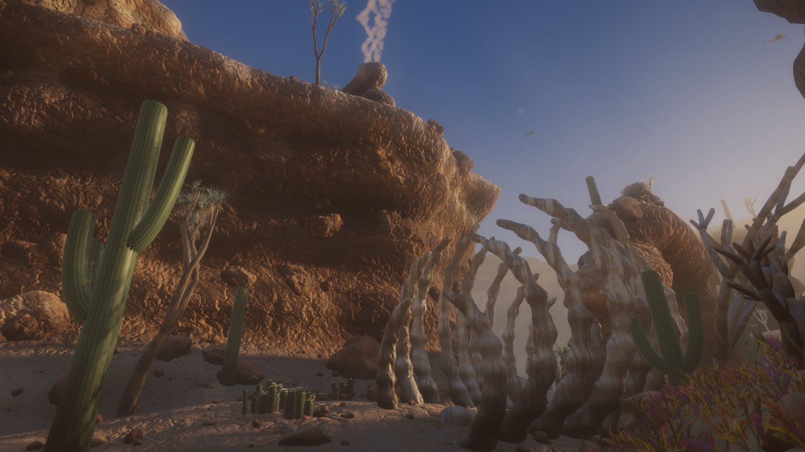
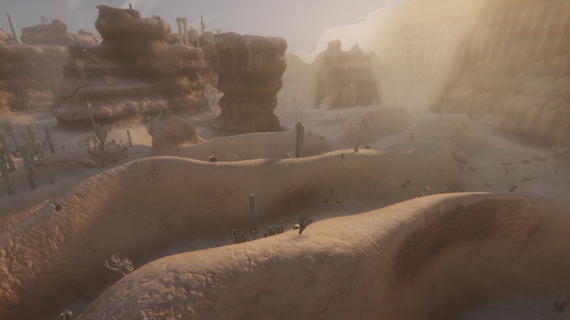
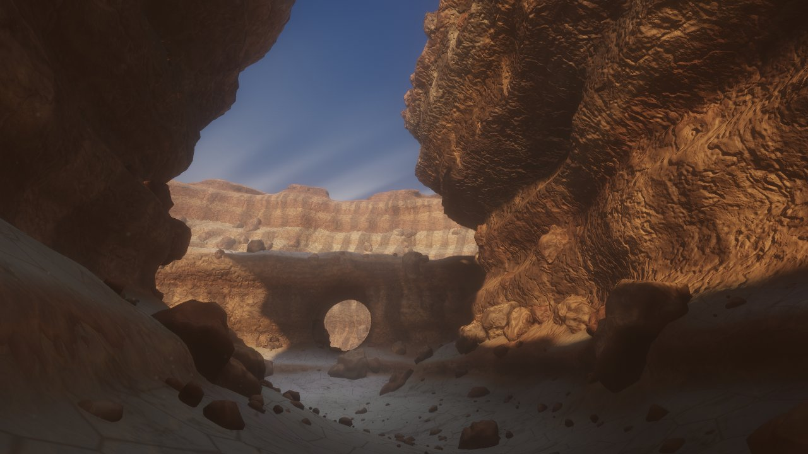

# Ochre Reach

A desert basin in the late afternoon that you can explore on foot in the browser:

- **Rock:** layered sandstone canyons, mesas, hoodoos and a natural arch.
- **Sand:** dune seas with rippled sand and a cracked white salt flat.
- **Plants:** columnar cacti with flowers, branching yucca-like trees, dead snags, prickly pear, barrels, agaves, dry grass and patches of wildflowers.
- **Movement:** tumbleweeds, dust devils, sand blowing along the ground and birds circling on thermals.
- **Set pieces:** a ruined colonnade and the skeleton of something enormous half swallowed by the sand.



It's built with the same methods as [Spore Hollow](../fungal-world) and the [Abyssal Garden](https://github.com/Noniv/abyssal-garden) engine it forks (MIT, by Maksymilian Dendura): a GPU density field, Surface Nets, seeded scatterers and one-off procedural meshes. Everything is generated at load; there are no image, model or sound files. The whole world is one ~120 KB HTML file.

## Try it

```bash
cd apps/desert-world
npm install
npm run build        # writes index.html
```

Open `index.html` in **Chrome** or **Edge** on a desktop computer (it needs **WebGPU**), wait for the world to be built, then press **Enter**.

| | |
|---|---|
| Look around | Mouse |
| Walk / run | `W` `A` `S` `D` / hold `Shift` |
| Jump | `Space` |
| Fly instead | `G` (`Q` / `E` down / up) |
| Viewpoints | `1` to `7` (`7` is the north-eastern dune sea) |
| Menu, mute, stats | `Esc`, `M`, `H` |

## How it is generated

1. **Rock** (`W_DENS` in `src/shaders.js`). The GPU density field keeps the original's hand-placed mesas, arches and tunnels, then changes:
   - Sandstone beds are carved as alternating hard ledges and soft recesses.
   - Jointing comes from vertically stretched cells.
   - About 30 hoodoos are added: slim spires with a wider caprock.
   - Fewer random plateaus are raised.
   - The crater rim becomes a ring of high cliffs.
2. **Dunes.**
   - **Shape:** transverse ridges across the wind, with a long gentle windward slope, a short steep slip face and crests bent by noise.
   - **Where:** they form on open ground away from rock. Six dune seas in the outer basin are kept free of hoodoos, plateaus, rocks and most plants.
3. **Sand and stone materials.**
   - **Sandstone:** beds of red, orange, cream and purple-brown, cross-bedding, and dark desert varnish streaking down steep faces.
   - **Sand:** covers upward faces and the dune seas, with wind ripples near the eye and single grains glinting in the sun.
   - **Gravel:** desert pavement in patches.
   - **Salt flat:** polygon-cracked crust.
4. **Plants** (`saguaro`, `branchTree`, `pear`, `ribTube` in `src/math.js`). Each is a one-off mesh sorted into the culling grid:
   - **Columnar cacti:** ribbed, with arms that turn upward and sometimes flowers.
   - **Branching trees:** a stiff blade rosette and a skirt of dead leaves at every branch tip.
   - **Dead snags:** bleached and twisting.

   The original's shared meshes are reused as barrel and organ-pipe cacti and dry brush. Six small instanced meshes add prickly pear, ball cacti, short columns and shrubs. Agaves, grasses and wildflowers use the instanced blade renderer.
5. **Moving things.**
   - **Wind:** one steady wind with gusts bends the grass and drives everything else.
   - **Blowing sand:** skims the ground, using a height map in the ground texture.
   - **Tumbleweeds:** roll and hop downwind across the terrain, then fade and start again upwind.
   - **Dust devils:** wander, lean downwind, come and go.
   - **Birds:** circle on thermals, banking into the turn, with a few wingbeats between long glides.
6. **Set pieces** (capsule SDFs meshed with Surface Nets, weathered with noise):
   - **Skeleton:** half buried in sand.
   - **Colonnade:** stacked column drums, some still carrying their beams, broken stumps and fallen drums, on the ledge above the eastern canyon.
7. **Light.**
   - **Sun:** a low sun 20° up casts long shadows that pick out the dunes and rock beds.
   - **Haze:** warm dust haze, densest low down.
   - **Shafts:** dusty light shafts in the canyons.
   - **Sky:** a clear blue sky with wisps of cirrus and a pale daytime moon.
   - **Ambient:** blue from the sky above, warm light bounced off the sand from below.
8. **On foot.** Walking, running and jumping use the terrain's distance field. Cactus and tree trunks are solid.
9. **Sound.** Synthesized live: a gusting wind that grows with altitude, sand ticks, a low drone, sparse notes and the occasional hawk cry.

| File | What's inside |
|---|---|
| `src/world.js` | Layout and every generator: hoodoos, plants, grasses, flowers, rocks, skeleton, ruins, dust devils, tumbleweeds, birds |
| `src/math.js` | Noise, Surface Nets, mesh builders, and the desert plant builders |
| `src/shaders.js` | WGSL: density and dunes, sky, haze, light shafts, sand and stone, plants, leaves, birds, tumbleweeds, dust |
| `src/main.js` | Renderer, camera, walking and flying, viewpoints |
| `src/audio.js` | The soundscape |
| `tools/shoot.cjs`, `tools/walktest.cjs` | Headless screenshots and the walking check (see the Spore Hollow README) |

## Status and known gaps

- **Not measured on a real GPU.** The screenshots come from Chromium's software WebGPU renderer. Use the `B` benchmark in `dev.html` (`npm run build:dev`) on real hardware.
- **Not tested on touch or mobile.**
- **The skeleton, ruins and small plants are not solid.** Rock, sand and cactus and tree trunks are.
- **The rock layout is the original underwater one, re-dressed.** The canyons and viewpoints sit where its reef canyons were.




## License

MIT, see [LICENSE](LICENSE). The original copyright notice is kept for the parts from Abyssal Garden.
