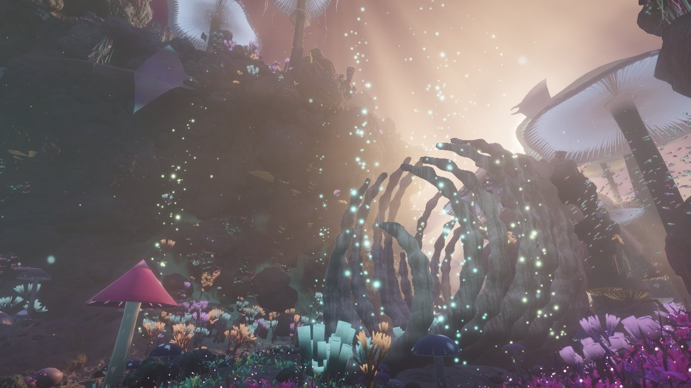
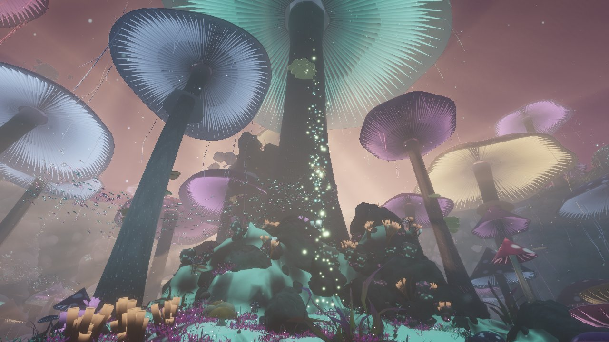
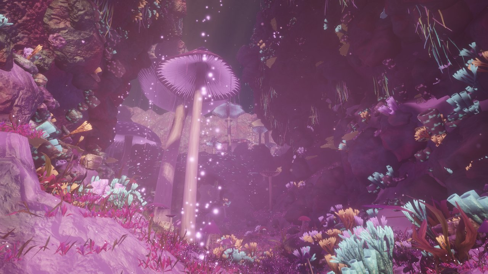

# Spore Hollow

An alien fungal basin at dusk that you can fly through in the browser. Giant mushrooms with glowing gills, god rays through spore haze, glowing moss and mycelium, floating rocks, flying creatures, a fossil ribcage and a ringed gas giant in the sky.

Everything is procedural: no images, models or sound files. The whole world is one ~116 KB HTML file.



It is a fork of [Abyssal Garden](https://github.com/Noniv/abyssal-garden) by Maksymilian Dendura (MIT). The engine and the rock layout come from that project. The air, light, fungi, life, set pieces and sound are new.

## Try it

```bash
cd apps/fungal-world
npm install
npm run build        # writes index.html
```

Open `index.html` in **Chrome** or **Edge** on a desktop computer (it needs **WebGPU**). Wait for the world to grow, then press **Enter**.

| | |
|---|---|
| Look around | Mouse |
| Fly | `W` `A` `S` `D` |
| Down / up | `Q` / `E` |
| Faster | Hold `Shift` |
| Viewpoints | `1` to `6` |
| Menu, mute, stats | `Esc`, `M`, `H` |

## How it is generated

The approach is the same as Abyssal Garden's: a 3D density field is sculpted on the GPU, meshed, and then dressed by seeded random scatterers that read the terrain.

1. **Basin.** A WebGPU compute shader fills a 512×96×512 grid with a density function (`W_DENS` in `src/shaders.js`). The hand-placed mesas, arches and tunnels come from the original. Changes:
   - Porous, bubbly stone replaces the layered beds.
   - The floor has rolling mounds.
   - A ring of jagged peaks forms the crater rim.
2. **Meshing.** Surface Nets turns the grid into the terrain mesh (`surfaceNets` in `src/math.js`). A flood fill first removes floating specks of noise.
3. **Giant mushrooms** (`giant()` in `src/world.js`). Each giant is a one-off mesh built by `shroom()` in `src/math.js`:
   - A noisy stem along a bent path, with a bulb at the base and sometimes a ring.
   - A cap from one of four profiles: parasol, dome, bell or funnel. The rim is wavy and the surface lumpy.
   - An underside with 24 to 170 real gill fins.

   Placement rules:
   - Giants grow in forest zones on floors with enough headroom.
   - Caps keep clear of the camera path, the viewpoints, creature flight paths, other caps and other stems.
   - Each giant gets glowing threads hanging from its rim, falling spores, floating spore glints, brackets climbing its stem and smaller mushrooms around its foot.
   - The giant meshes are sorted into the 16×16 culling grid, like the terrain.
4. **Small fungi.** Fourteen shared meshes are instanced tens of thousands of times: domes, bells, parasols, funnels, clusters, puffballs, brackets and lanterns. Each instance gets its own hue and glow. Brackets attach to walls, facing along the wall normal. Lanterns hang from overhangs.
5. **Light.**
   - **Sun:** a low evening sun with a 4096² shadow map that includes every cap.
   - **Haze:** an analytic height fog for the spore haze, densest on the basin floor.
   - **God rays:** marched through the shadow map at half resolution.
   - **Sky:** includes stars, cloud bands and a ringed gas giant.
   - **Glow volume:** every glowing thing adds light to a half-resolution 3D texture. It is blurred through open air and blocked by rock, so gills, moss and spore vents light their surroundings. This is how the scene gets bioluminescent light without per-light shadows.
   - **Cap shade:** caps also block skylight in the same volume, so it is darker under the canopy.
6. **Ground.**
   - **Mycelium:** a glowing web through the soil, thickest around each giant's foot. It reuses the original's animated caustic texture, slowed down.
   - **Moss:** magenta and teal glow-moss carpets, pale mycelium mats and moss on stone.
7. **Set pieces.**
   - **Ribcage:** a half-buried fossil ribcage and skull built from smooth-blended capsules (an SDF meshed with Surface Nets).
   - **Fallen giant:** a toppled giant resting on its cap in the eastern canyon.
   - **The Elder:** a 47 m parasol whose cap rises above everything else.
8. **Life.** Schools of glowing skyfish, ray-like gliders with bioluminescent spots, rising spore motes from vents and spores falling from every gill.
9. **Sound.** Synthesized live: wind that grows with altitude, an A-minor drone, glassy chimes, spore pops and distant calls.

| File | What's inside |
|---|---|
| `src/world.js` | Layout and every generator: giants, small fungi, leaves, moss, rocks, set pieces, motes, light volume |
| `src/math.js` | Noise, Surface Nets, mesh builders, and the fungus builders `shroom`, `puff` and `shelf` |
| `src/shaders.js` | WGSL: density, sky, fog, god rays, terrain, fungi, leaves, creatures, sprites, post |
| `src/main.js` | Renderer, camera, controls, viewpoints, camera path |
| `src/audio.js` | The soundscape |
| `src/quality.js` | Low / Medium / High detail levels |
| `src/dev.js` | Dev tools, only in `dev.html` (`npm run build:dev`): fly-through (`F`), benchmark (`B`), screenshot hooks |
| `tools/shoot.cjs` | Headless screenshots of `dev.html` through Chromium's software WebGPU |

## Screenshots without a GPU

```bash
npm run build:dev
node tools/shoot.cjs 1,2,3,4,5,6 0 1280 720 shots/pose               # viewpoints, High detail
node tools/shoot.cjs "[38,-14,-36,6,2,-88]" 2 800 450 shots/elder      # any camera: position, look-at
```

This renders with SwiftShader (on the CPU) into an offscreen texture: `dev.html#off`. It takes about 30 to 90 s per frame. The frame times it gives say nothing about real performance.

## Status and known gaps

- **Not yet measured on a real GPU.** The screenshots come from the software renderer. The original runs at about 180 fps on an RTX 5070 Ti. This version draws more:
  - about 2–3 million triangles of one-off mushrooms
  - a 14-mesh instanced fungus pass
  - more expensive fog and sky

  The dynamic resolution and draw-distance tuning are still there. Run the `B` benchmark in `dev.html` on real hardware before relying on frame rates.
- **Not tested on touch or mobile.** Low and Medium reduce mushroom detail and density, but haven't been tried on phones.
- **Collision is terrain-only.** Mushroom stems, caps and the ribcage are not solid. You fly through them.




## License

MIT, see [LICENSE](LICENSE). The original copyright notice is kept for the parts from Abyssal Garden.
