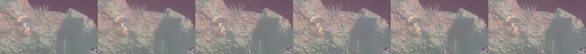
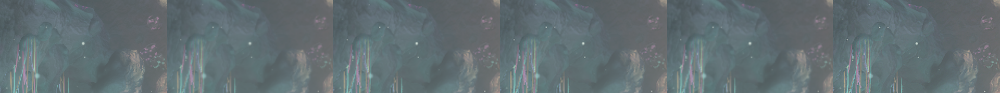
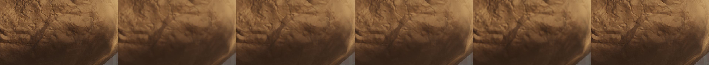

# Results: Neural Engine upscaler viability

## Machine

- MacBook Pro, **Apple M2 Pro**, 16 GB unified memory
- macOS **27.2** (build 26B123), Xcode 27.1 (27A9275), Swift 6.4
- Step 1 conditions: **on battery** (user's choice; charger not available at the time), **Low Power Mode off**, no other heavy apps running (Safari, VS Code and the Claude app open but idle). No thermal or performance warnings were recorded (`pmset -g therm`). Battery went from 32% to 24% over the runs.
- Each benchmark was run twice, back to back; the tables report the **second run**. Raw output for both runs is in [`results/step1/`](results/step1/).

## Code changes

- **`bench/` compiled with no errors and needed no source changes** (`swift build -c release`, Swift 6.4, tools-version 5.7 package).
- Because `infer()` discards prediction errors (`try?`), a failed prediction would show as a fast, fake time. A separate check confirmed every model predicts successfully on both `.cpuAndNeuralEngine` and `.cpuAndGPU`, with fp16 inputs and outputs of the expected shapes.
- **`train.py`: the image cache now stores uint8 instead of float32.** At float32 the 540 training pairs need about 30 GB, and on this 16 GB Mac the first full run was killed silently by macOS before step 500. The 50-step test swapped at 2.3 s per step. Crops are converted to float when the batch is built, so the training is otherwise identical. It now runs at about 39 ms per step.
- `.gitignore`: added `.venv/`.
- Added [`tools/ane_plan.swift`](tools/ane_plan.swift): reports each op's preferred compute device using `MLComputePlan`. It stands in for Xcode's Performance report; see below.

## Step 1: speed

### Latency (500 runs, no GPU load), ms

| Model | ANE median | ANE p99 | GPU median | GPU p99 | GPU ÷ ANE (median) |
|---|---|---|---|---|---|
| tiny | 3.80 | 4.05 | 5.86 | 7.07 | 1.5× |
| small | 4.64 | 5.46 | 8.23 | 9.54 | 1.8× |
| medium | 9.03 | 10.03 | 21.28 | 23.68 | 2.4× |
| temporal | 4.83 | 5.26 | 9.00 | 10.58 | 1.9× |
| blend | 2.52 | 4.66 | 5.46 | 8.39 | 2.2× |

The ANE is clearly faster than the GPU for every model, so none of them look like they are secretly falling back to the GPU. The measured ANE times are a bit better than the README's guesses for small and medium (about 5 and 13 ms guessed), and worse for tiny (about 2 ms guessed). tiny's 3.8 ms floor for 7.8 billion multiply-adds suggests that fixed cost dominates at this size: moving 2560×1440 fp16 tensors in and out, plus dispatch.

### Contention (10 ms synthetic GPU load per frame, one inference per 60 Hz frame, 8 s per phase), ms

| Model | GPU load alone (median / p99) | + model on ANE: GPU frame added (median / p99) | ANE latency under load (median / p99) | + model on GPU: GPU frame added (median / p99) | GPU-run latency (p99) |
|---|---|---|---|---|---|
| tiny | 9.34 / 10.00 | **+0.32 / +0.07** | 4.39 / **4.76** | +4.13 / +4.94 | 10.20 |
| small | 9.79 / 11.02 | **−0.01 / −0.14** | 5.48 / **9.50** | +5.76 / +9.18 | 15.42 |
| temporal | 9.94 / 11.26 | **−0.00 / −0.25** | 7.97 / **8.84** | +7.03 / +9.70 | 16.79 |
| blend | 9.94 / 11.84 | **−0.00 / −0.21** | 3.06 / **5.10** | +3.96 / +3.38 | 11.91 |
| small, `--load-ms 14` | 13.37 / 14.20 | **−0.15 / +0.03** | 5.17 / **7.40** | +8.97 / +12.60 | 13.71 |

First run, for comparison (ANE p99 under load): tiny 7.31, small 9.78, temporal 9.10, blend 3.46, small at 14 ms 8.11. The first run's tiny p99 (7.31) was noisier, but it still fit the budget.

`medium` was not run under contention: its *unloaded* median of 9.0 ms is already over the 8 ms budget.

### MetalFX (GPU, 1280×720 → 2560×1440, 290 frames), ms

| Scaler | median | p99 |
|---|---|---|
| MetalFX temporal | 2.32 | 2.77 |
| MetalFX spatial | 0.67 | 1.00 |

### Neural Engine placement

Xcode 27.1 has no command-line way to create the Core ML Performance report: `coremlc` and `coremlcompiler` only compile and generate code. Instead I used `MLComputePlan`, the Core ML API that reports the device each op is planned to run on. It was run with compute units `.cpuAndNeuralEngine`.

| Model | Ops on the Neural Engine | Ops on GPU or CPU | Estimated cost off the ANE |
|---|---|---|---|
| tiny | 15 | 0 | 0% |
| small | 19 | 0 | 0% |
| medium | 23 | 0 | 0% |
| temporal | 20 | 0 | 0% |
| blend | 14 | 0 | 0% |

**No fallbacks: every op of every model is placed on the Neural Engine.** This agrees with the latency table: the ANE runs are 1.5 to 2.4 times faster than the GPU runs, and add essentially no GPU time.

### Step 1 verdict against the README criteria

| Model | ANE p99 under load ≤ 8 ms | Adds < ~0.5 ms GPU | Clearly cheaper than the same model on the GPU and than MetalFX temporal (2.32 ms) | Result |
|---|---|---|---|---|
| tiny | ✅ 4.76 (first run 7.31) | ✅ +0.32 / +0.07 | ✅ vs +4.13 GPU, 2.32 MetalFX | **PASS** |
| small | ❌ 9.50 (first run 9.78); 7.40 at 14 ms load | ✅ ≈0 | ✅ | **FAIL** (borderline) |
| medium | ❌ 9.03 median with no load | — | — | **FAIL** |
| temporal | ❌ 8.84 (first run 9.10) | ✅ ≈0 | ✅ | **FAIL** (borderline) |
| blend | ✅ 5.10 (first run 3.46) | ✅ ≈0 | ✅ vs +3.96 GPU, 2.32 MetalFX | **PASS** |

**What this means:** only `tiny` and `blend` pass. By the README's rule, the full-network approach at `small` size or above is dead on the M2 Pro, and the hybrid design (GPU reprojects, ANE predicts blend weights) is still possible. tiny passes too, so step 2 checks whether a network that small is good enough on its own.

Observations:
- Running on the ANE has a near-zero GPU cost. Even sharing memory bandwidth with a 256 MB-streaming GPU load, the GPU frame time is unchanged within noise. This is the strongest result here.
- The ANE's p99 is the limit, not its median. small and temporal have medians of 5.5 and 8.0 ms under load, but long tails. small's p99 was *lower* with a heavier GPU load (7.40 vs 9.50 ms). That points to scheduling jitter on the CPU and ANE, which is the transfer and dispatch path, rather than GPU contention. These two models are borderline, not clearly out.
- These runs were on battery. Apple Silicon runs at nearly the same speed on battery with Low Power Mode off, but tail latencies could be slightly better on mains power.

## Step 2: quality

Only **`tiny`** was trained. `blend` passed step 1, but `train.py` only trains the colour-only models (tiny, small, medium). blend predicts blend weights for a GPU reprojection pass that doesn't exist yet, so its quality can't be measured frame by frame. small did not pass step 1.

### Setup

- Both worlds' `dev.html` were built and **300 pairs per world** were captured with `capture.cjs`. Headless Chrome had a working WebGPU adapter, so `--headed` was not needed. It took about 5 s per pair for fungal and 0.9 s for desert.
- Pair check: input and target were compared visually at full frame (`fungal 0000`, `0281`; `desert 0150`, `0280`). They are the same frame, camera and moment.
- One systematic difference: the 2560×1440 target is on average **0.1–0.3% darker** than the 1280×720 input (−0.0033 / −0.0011 mean RGB for fungal / desert, never positive by more than 0.0002) and has slightly more contrast. This is probably resolution-dependent fog and bloom in the supersampled render. A trained network can learn this offset and the fixed filters can't, so it gives the network a small, unearned PSNR edge.
- Training: `python train.py --data data/fungal data/desert --model tiny --steps 20000` on MPS, on mains power. It took about 39 ms per step once all images were cached, roughly 13 minutes in total, and the L1 loss flattened at about 0.0081 by step 10k. Summary: [`results/step2/tiny_train_summary.txt`](results/step2/tiny_train_summary.txt).
- MetalFX spatial images: `bench metalfx-images` on each world's 30 held-out frames (`0270`–`0299`), written to separate `data/metalfx_fungal` and `data/metalfx_desert` folders. Each world was evaluated on its own with `--eval-only --metalfx data/metalfx_<world>`, because both worlds use the same file names.

### Scores on the held-out frames (30 per world)

PSNR and SSIM: higher is better. LPIPS: lower is better.

**Spore Hollow (fungal)**

| Method | PSNR | SSIM | LPIPS |
|---|---|---|---|
| bilinear | 34.24 | 0.9393 | 0.1396 |
| bicubic | 34.71 | **0.9476** | 0.1164 |
| Lanczos | 34.68 | 0.9473 | 0.1203 |
| **tiny (trained)** | **35.01** | 0.9429 | 0.1395 |
| MetalFX spatial | 33.74 | 0.9356 | **0.0713** |

**Ochre Reach (desert)**

| Method | PSNR | SSIM | LPIPS |
|---|---|---|---|
| bilinear | 37.84 | 0.9607 | 0.1193 |
| bicubic | 38.30 | **0.9669** | 0.0852 |
| Lanczos | 38.26 | 0.9668 | 0.0834 |
| **tiny (trained)** | **39.05** | 0.9644 | 0.1136 |
| MetalFX spatial | 37.71 | 0.9599 | **0.0511** |

### Crops

Each strip shows, left to right: **target, bilinear, bicubic, Lanczos, tiny, MetalFX spatial.** These are centre crops of 320×180 output pixels, shown at 2× nearest-neighbour.

`tiny` looks only slightly better than bilinear: soft, with fine rock texture and thin strands smeared out. MetalFX spatial is visibly the closest to the target on texture and edges, which matches its much better LPIPS. tiny's PSNR win of +1.3 dB comes from being smooth and correctly coloured *on average*, which is what an L1-trained network does, plus the small brightness offset above. It does not recover detail.

### Trained tiny: speed is unchanged

Converted with `convert('tiny', 'runs/tiny.pt', out_dir='runs/models')` from `convert.py`, so the committed random-weight model was not overwritten. `MLComputePlan` still puts all 15 ops on the Neural Engine. **Note: the charger had been disconnected by this point, so these runs were on battery** (Low Power Mode off).

| | Random weights (step 1) | Trained (run 2) | Trained (run 1) |
|---|---|---|---|
| ANE latency, no load (median / p99) | 3.80 / 4.05 | 4.09 / 4.69 | — |
| ANE latency under load (median / p99) | 4.39 / 4.76 | 4.79 / 7.08 | — / 8.21 |
| Added to GPU frame by ANE (median / p99) | +0.32 / +0.07 | +0.00 / +1.00 | +0.01 / −0.27 |
| Added to GPU frame by the same model on the GPU (median) | +4.13 | +4.55 | +3.32 |

The medians are the same within noise, so trained weights don't change the speed. The p99 is noisy from run to run on battery: 7.08 in one run and 8.21 in the other, either side of the 8 ms line. tiny's tail latency has much less headroom than step 1's second run suggested.

### Step 2 verdict

**tiny fails step 2.** It beats MetalFX spatial on PSNR (+1.3 dB in both worlds) but loses clearly on LPIPS: 0.140 vs 0.071 for fungal and 0.114 vs 0.051 for desert, about twice as far from the target. It also looks worse on the hard cases: thin strands, rock and sand texture, particles. The README asks for a clear win on *both* metrics and visually.

## Verdict: **go with the GPU-does-the-heavy-lifting design only**, and only as a conditional next experiment. **No-go** for an ANE upscaling network.

Reasoning:

1. **A full upscaling network on the ANE is a no-go on the M2 Pro.**
   - Networks big enough to add real detail (`small`, `temporal`, `medium`) don't fit the 8 ms p99 budget under load.
   - The one that fits (`tiny`) is visibly and measurably worse than MetalFX spatial. MetalFX spatial costs only 0.67 ms of GPU time, so tiny's GPU saving of about 0.35–0.65 ms isn't worth a custom upscaler that looks worse. That is the README's "if it only matches MetalFX" case, and tiny doesn't even match it.
2. **The ANE is effectively free for the GPU, and that is the one strong positive.** Every model added ≈0 ms to a GPU frame that was busy with a 256 MB-streaming load. Running the same models on the GPU cost 3–9 ms.
3. **That keeps only the hybrid design alive.**
   - `blend` passed step 1 comfortably: p99 5.1 ms, ≈0 GPU cost.
   - Its job is not to make detail but to make per-pixel decisions about how much history to keep and how much to sharpen. A 7-GMAC network is far better suited to that than to producing detail itself, so tiny's quality failure says little about blend.
   - Its real competitor is **MetalFX temporal at 2.3 ms of GPU time**, plus whatever the custom reprojection pass costs on the GPU.
   - So the design is only worth building if (a) the renderer gets motion vectors and jitter anyway, and (b) the custom reprojection plus ANE blend weights comes out clearly cheaper than 2.3 ms or clearly better looking than MetalFX temporal.
   - Otherwise, **use MetalFX temporal**: it is the default answer here.

### Caveats

- Step 1 and the trained-model re-check ran on battery, with Low Power Mode off and no thermal warnings. Capture and training ran on mains power.
- Tail latency is noisy: tiny's p99 ranged from 4.8 to 8.2 ms across four runs. A real integration with IOSurface buffers shared between Metal and Core ML, instead of copying fp16 tensors, should cut both the median and the tail. That could bring `small` and `temporal`, which were borderline at 8.8–9.8 ms, inside the budget.
- The GPU load is synthetic, and the input is the final tone-mapped image (see the README's list of what these results don't tell you yet).

### Proposals (not applied: they change the training or the design)

- **Perceptual loss for tiny or small.** These networks were trained with plain L1, which favours smooth, PSNR-friendly output. Adding an LPIPS or VGG feature loss, or a light adversarial term, is the standard way to trade a little PSNR for real texture. It would be a fairer test of whether a 7–17 GMAC network can beat MetalFX spatial on LPIPS. If small came within budget with zero-copy input, it would be the one to try.
- **Zero-copy timing first.** Before anything else, re-time `small` and `temporal` with IOSurface-backed `MLMultiArray`/`CVPixelBuffer` input and output. Their misses were close, and transfer cost is likely a big part of both the 3.8 ms floor and the tail.
